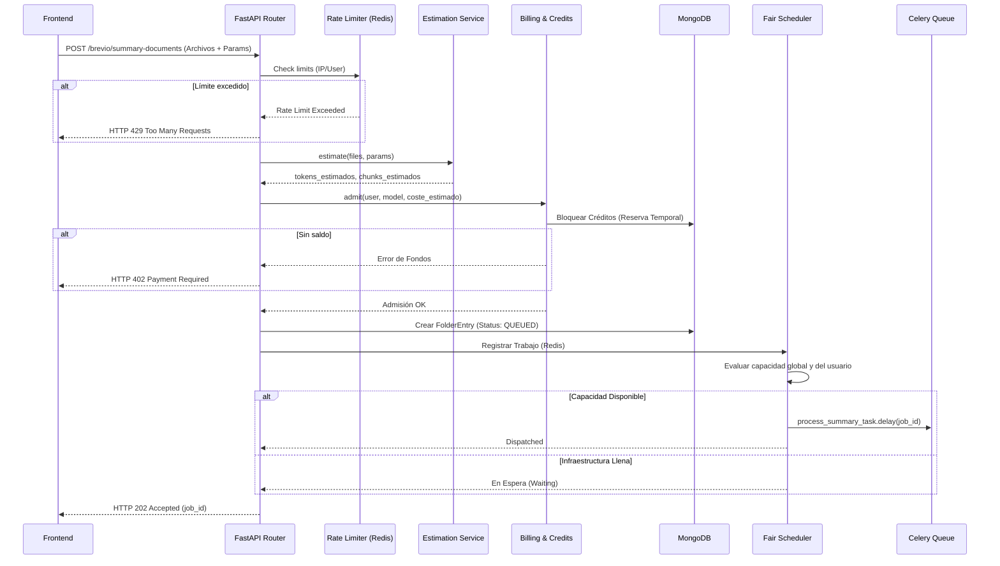

# Flujo de Datos Interno

Este diagrama muestra cómo fluye la información dentro de las capas del backend desde que se recibe una petición HTTP hasta que un trabajo es despachado al Worker de Celery.

## Persistencia vs Volatilidad

*   **Base de Datos (MongoDB):** Fuente de la verdad absoluta. Si Redis se borra accidentalmente, los trabajos en estado `PROCESSING` o `QUEUED` en Mongo no se pierden, aunque podrían necesitar una intervención manual o un script de reconciliación para volver a encolarlos en Celery.
*   **Caché (Redis):** Es totalmente volátil y efímero. Se asume que cualquier registro aquí tiene un TTL (Time To Live). Guarda las reservas temporales (inflight requests), rate limits y el estado temporal de SSE.
