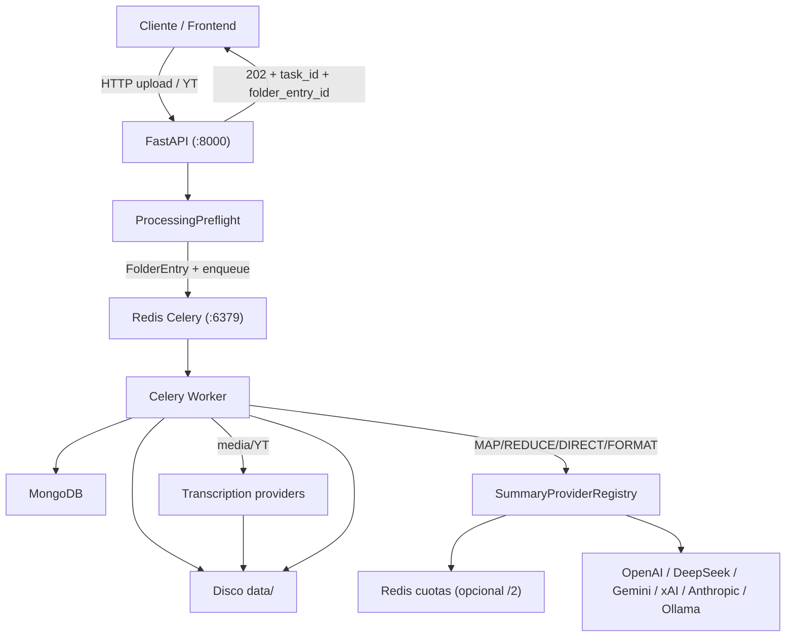
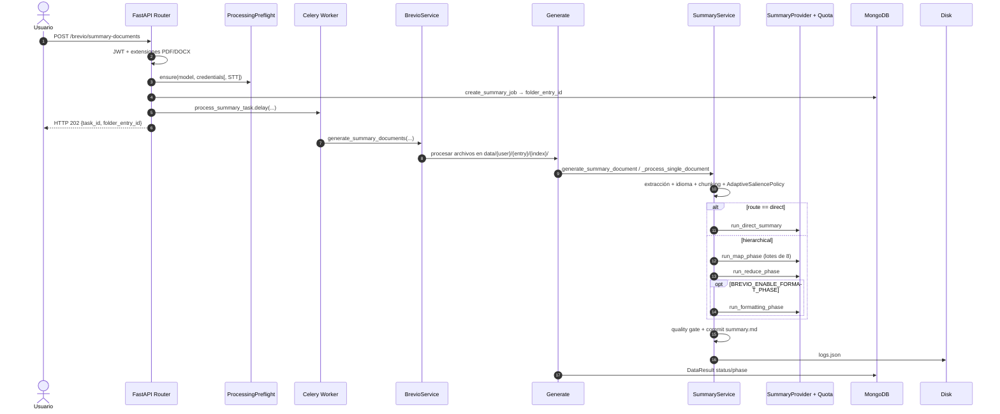
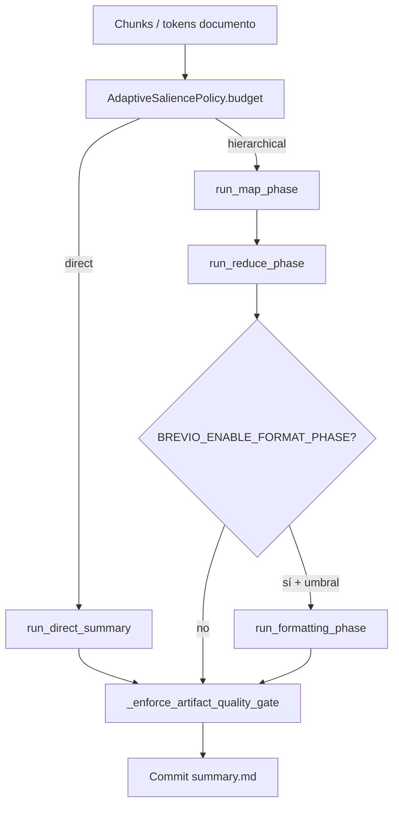
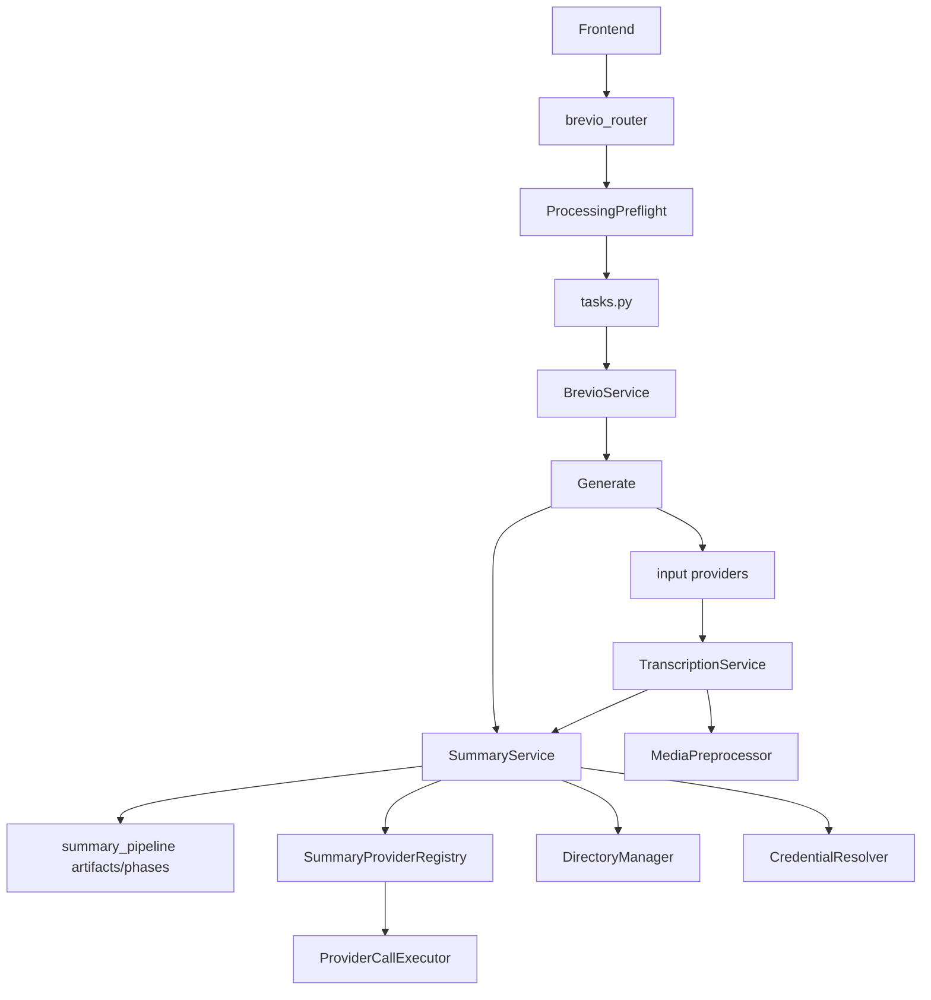

# Arquitectura de BrevioAI: Pipeline de Generación de Resúmenes

Documentación técnica basada en la inspección directa del código fuente. Describe la arquitectura **real** del pipeline de resúmenes: componentes, flujos, proveedores, cuotas, fases DIRECT/MAP/REDUCE/FORMAT, artefactos en disco y procesamiento asíncrono.

Inventario canónico de variables de entorno: [`docs/ENVIRONMENT.md`](ENVIRONMENT.md).

---

## 1. Arquitectura general

BrevioAI es una plataforma desacoplada (API + workers Celery) para resumir documentos, audio/vídeo subido y listas de reproducción de YouTube.

### 1.1 Servicios del ecosistema

1. **Backend (API REST FastAPI)**
   - Entrada HTTP en el puerto `8000`.
   - `core/brevio_api/__main__.py` + `core/brevio_api/routers/brevio_router.py`.
   - JWT, validación Pydantic/extensiones, **preflight** de acceso/credenciales, creación de `FolderEntry`, encolado Celery.

2. **Celery Workers**
   - `core/brevio_api/celery.py`, tareas en `core/brevio_api/tasks.py`.
   - Timeouts típicos en Compose: `--time-limit=7200` / `--soft-time-limit=3600`.
   - Ejecuta extracción, STT (si media), chunking, llamadas LLM vía proveedores, síntesis y persistencia.

3. **Redis**
   - Broker/result backend Celery (DB `0`).
   - Opcional: cuotas de proveedor en otra DB (`PROVIDER_QUOTA_REDIS_URL`, p. ej. `/2`).
   - Streams SSE opcionales (`EVENTS_REDIS_URL`).

4. **MongoDB**
   - `core/brevio_api/core/database.py`.
   - Colecciones: `users`, `entries` (`FolderEntry` con `results` embebidos / `DataResult` con `status` + `phase`).

5. **Proveedores de resumen (LLM)**
   - Registro: `core/brevio/services/summary_providers/`.
   - OpenAI-compatible: OpenAI, DeepSeek, Google (Gemini), xAI, Ollama.
   - Nativo: Anthropic (`AnthropicSummaryProvider`).
   - Cliente/credenciales: `ApiService` + `CredentialResolver` + `ProviderRegistry`.
   - Cada completion pasa por `ProviderCallExecutor` (cuotas/reintentos).

6. **Transcripción (STT) pluggable**
   - Fachada: `TranscriptionService`.
   - Proveedores: OpenAI, Google, xAI, Whisper local (`transcription/`).
   - Preproceso FFmpeg: `MediaPreprocessor`.
   - Entrada media: `services/input/` (`YouTubeInputProvider`, `UploadedMediaInputProvider`).

7. **Frontend**
   - Vite; puertos `3000` (dev) / `80` (prod vía Compose).

8. **Disco**
   - `data/` (`Constants.DESTINATION_FOLDER`).
   - Telemetría: `core/brevio_api/logs/logs.json`.
   - Auditoría opcional: `data/audit/`.

### 1.2 Diagrama de servicios



### 1.3 Variables de entorno relevantes al pipeline

Detalle completo en [`ENVIRONMENT.md`](ENVIRONMENT.md). El pipeline **no** lee `MAX_TOKENS_PER_CHUNK`, `REDUCE_BATCH_TOKENS`, `MAX_COMPRESSION_ROUNDS` ni `TARGET_COMPRESSION_RATIO`: esos límites salen de `ModelCapabilities` y de `AdaptiveSaliencePolicy`.

| Variable | Default | Propósito |
| :--- | :--- | :--- |
| `TEMPERATURE` | `0.2` | Legacy / `ConfigModel`; el job usa `generation_temperature(caps)` |
| `MAX_TOKEN_PER_MINUTE` | `200000` | Bucket TPM **local al proceso** (no es TPM del proveedor) |
| `MAX_TOKEN_WAIT` | `300` | Espera máxima del bucket local |
| `MAX_TOKENS` | `4096` | Solo fallback de `ConfigModel` |
| `BREVIO_ENABLE_FORMAT_PHASE` | apagado | FORMAT opt-in |
| `BREVIO_KEEP_PARTIALS` | `false` | Conservar `summary.md.partial` |
| `BREVIO_MIN_TOKENS_FOR_POSTPROCESS` | caps | Umbral extra para saltar FORMAT |
| `BREVIO_ALLOW_MAP_ORIGINAL_TEXT_FALLBACK` | `false` | Si MAP falla, inyectar texto original en REDUCE (off = fail-closed) |
| `PROVIDER_QUOTA_ENABLED` | `false` | Cuotas distribuidas Redis |
| `PROVIDER_QUOTA_CONFIG_PATH` | — | YAML de políticas RPM/in-flight/TPM |
| `PROVIDER_QUOTA_REDIS_URL` | broker `/2` | Redis de cuotas |
| `{PROVIDER}_API_KEY` / `{PROVIDER}_API_URL` | por proveedor | Credencial / URL |
| `ENABLED_SUMMARY_PROVIDERS` | todos | Allowlist de resumen |
| `SUMMARY_LOCAL_USER_ACCESS` | no-prod true | Visibilidad Ollama |
| `ENABLED_TRANSCRIPTION_PROVIDERS` | — | Allowlist STT |
| `TRANSCRIPTION_DEFAULT_PROVIDER` | whisper/openai según env | STT por defecto |
| `WHISPER_LOCAL_USER_ACCESS` | no-prod true | Whisper local en UI |
| `DEV_ALLOW_PLATFORM_OVERRIDE` | `true` | Claves de plataforma en development |
| `FFMPEG_TIMEOUT` | `300` | Preprocesador de media |

---

## 2. Flujo completo de un documento



### Etapas (ruta documento)

1. **Recepción**: `POST /brevio/summary-documents` (multipart: files + `language`, `model`, `category`, `style`, `format`, `summary_level`, opcionales `reasoning_effort`, etc.).
2. **Validación de extensión**: PDF/DOCX; media usa `.mp3` (y equivalentes del enum).
3. **JWT**: `get_current_user`.
4. **Preflight**: `ProcessingPreflight.ensure` — acceso al modelo de resumen, credenciales (BYOK/plataforma) y, si aplica, acceso STT. Falla **antes** de trabajo de pago en Celery.
5. **Job en Mongo**: se crea `FolderEntry` y se obtiene `folder_entry_id` en la API (no solo en el worker).
6. **Encolado**: `process_summary_task.delay(...)` → **202** con `task_id` y `folder_entry_id`.
7. **Persistencia de entrada**: bytes en `data/{user_folder_id}/{folder_entry_id}/{index}/`.
8. **Cliente LLM**: `ApiService._initialize_client` + `CredentialResolver`.
9. **Extracción**: `DirectoryManager.read_pdf` / `read_docx` (OCR tesseract en páginas PDF sin texto).
10. **Idioma del documento**: `detect_language_with_retry_safe(full_text[:2000])` → telemetría `language_input`. Los prompts se resuelven por **idioma de salida** (`prompt_config.language`), no por el detectado.
11. **Tokens del archivo**: encoder del modelo → `HistoryTokenModel.num_tokens_file`.
12. **TOC front-matter**: `strip_document_front_matter_toc` antes del chunking; chunks TOC pueden emitir stubs MAP sin LLM.
13. **Chunking**: `SummaryService.chunk_text` con `ModelCapabilities.max_tokens_per_chunk` y overlap derivado (tope 0.2).
14. **Routing**: `AdaptiveSaliencePolicy.budget` → `route="direct"` o `"hierarchical"`.
15. **DIRECT** (docs cortos que caben): una sola completion con `get_direct_summary_prompt`; escribe `.partial` y salta MAP/REDUCE/FORMAT.
16. **MAP**: lotes de 8; `MapChunkResult` por chunk; fallos fail-closed por defecto; append incremental a `summary.md.partial`.
17. **REDUCE**: jerárquico con presupuestos por modelo; rondas intermedias/finales acotadas; subdivisión ante truncamiento hasta `REDUCE_SPLIT_SAFETY_CAP`.
18. **FORMAT** (opt-in): solo si `BREVIO_ENABLE_FORMAT_PHASE` y el artefacto supera el umbral de postproceso. Por defecto **no corre**; REDUCE/DIRECT ya emiten Markdown.
19. **Quality gate**: `_enforce_artifact_quality_gate` sobre el `.partial` real; puede fallar closed (`QUALITY_FAILED`) o elegir salvamento MAP.
20. **Commit**: `SummaryArtifactManager` promueve a `summary.md` de forma atómica; limpia parciales salvo `BREVIO_KEEP_PARTIALS`.
21. **DOCX/PDF**: **no** se generan en el hot path del resumen; se materializan bajo demanda en descarga (`BrevioService` + `DirectoryManager.create_docx_version` / `create_pdf_version`).
22. **Telemetría**: `HistoryTokenModel` → `logs.json`.
23. **Mongo**: `DataResult` con `success`, `status`, `phase`, rutas, errores.
24. **Consulta cliente**: entradas/folders + SSE de progreso según configuración.

### Ruta media / YouTube (misma síntesis)

```
Upload/YT → input provider → MediaPreprocessor → TranscriptionService
  → transcription.txt → SummaryService._process_single_transcription
  → generate_summary_document (mismo pipeline DIRECT/MAP/REDUCE[/FORMAT])
```

La ruta de transcripción **reutiliza** el pipeline de documentos; no hay un segundo orquestador legacy.

---

## 3. Ingesta y extracción

### 3.1 `DirectoryManager` (`core/brevio/managers/directory_manager.py`)

Usado en el pipeline real:

- **PDF**: `pypdf`; OCR (`pdf2image` + `pytesseract`, `spa+eng`) si la página no tiene texto.
- **DOCX**: `python-docx` en thread.
- **Transcripción**: `read_transcription()` sobre `transcription.txt`.
- **Escritura**: `write_summary` → `summary.md`.
- **Export**: `create_docx_version` / `create_pdf_version` (bajo demanda).

### 3.2 `DocumentExtractionService` (estimación)

`core/brevio_api/services/estimation/document_extraction_service.py` — streams en memoria para `/brevio/estimate-documents` (pdf/docx/txt/md, metadatos de OCR).

### 3.3 Media

| Pieza | Rol |
| :--- | :--- |
| `media_input_provider_for` | Factory URL→YouTube / path→upload |
| `YouTubeInputProvider` | `YTService` + `yt-dlp` → MP3 |
| `UploadedMediaInputProvider` | Copia el media al destino |
| `MediaPreprocessor` | FFmpeg: WAV 16k mono (Whisper local) o MP3 64k (cloud); split OpenAI 24MB |
| `TranscriptionService` | Resuelve proveedor/modelo y escribe `transcription.txt` |

---

## 4. Chunking

### 4.1 Producción

Única entrada del pipeline: `SummaryService.chunk_text()` en `summary_service.py`.

`core/shared/utils/chunking_utils.py` aporta utilidades (TOC, outline, stubs); el corte de tokens del job vive en `SummaryService`.

### 4.2 Parámetros

| Parámetro | Origen |
| :--- | :--- |
| Tamaño de chunk | `ModelCapabilities.max_tokens_per_chunk` (p. ej. 3000; GPT-5.6 = 4000) |
| Overlap efectivo | `min(0.2, chunk_overlap / max_tokens_per_chunk)` |
| Encoder | `get_encoder(model)` |

Ejemplos de batch REDUCE (no hay “6000 global”):

| Modelo (caps típicas) | `max_tokens_per_chunk` | `reduce_batch_tokens` |
| :--- | ---: | ---: |
| GPT-4o-mini | 3000 | 16000 |
| DeepSeek (familia) | 3000 | ~8000 |
| Contextos locales estrechos | 3000 | ~3500 |

### 4.3 Algoritmo

Corte **por tokens** con solapamiento (slice BPE), no por párrafos. Metadatos de orden = índice de lista.

### 4.4 Split estructural (solo FORMAT)

Si FORMAT está activo, `_split_markdown_structurally` parte por párrafos / frases / líneas / hard-split, respetando fences de código.

---

## 5. Fase MAP

- **Orquestación**: `run_map_phase` + `generate_summary_chunk`.
- **Prompt**: `AdvancedPromptGenerator.get_map_prompt(target_language, …, summary_level=…)`.
- **Concurrencia**: `max_concurrent_chunks = 8`.
- **Salida canónica**: `List[MapChunkResult]` (`SUCCESS` / `FAILED` / stubs TOC).
- **Límite de completion**: `_map_completion_token_limit` + `AdaptiveSaliencePolicy` / `MAP_COMPLETION_HEADROOM` (1.35) — no el antiguo `min(max_tokens, user_tokens*0.6+200)` como diseño central.
- **Cuotas**: cada call vía `ProviderCallExecutor` (`RetryCoordinator` único para retries de proveedor).
- **Bucket local**: `_check_token_limit` con `MAX_TOKEN_PER_MINUTE` (backpressure del worker).
- **Fail-closed**: con `BREVIO_ALLOW_MAP_ORIGINAL_TEXT_FALLBACK=false` (default), un MAP fallido **no** mete el PDF original en REDUCE → `MapPhaseFailedError`.
- **Parciales**: `SummaryArtifactManager.append_partial` por chunk/lote.

`BrevioRateLimiter` (`rate_limiter.py`) **no** está cableado en el path de producción.

---

## 6. REDUCE, DIRECT y FORMAT



### 6.1 DIRECT

Condición típica: un solo chunk / documento que cabe en contexto útil (~≤ `max_tokens_per_chunk` y ≤ ~90% del input disponible). Una completion con `get_direct_summary_prompt`.

### 6.2 REDUCE jerárquico

- Entrada canónica: `MapChunkResult`; legacy `str` / `ReduceChunk` solo para tests.
- Packing según `reduce_batch_tokens` / `reduce_input_token_budget` / `FINAL_REDUCE_PACK_CAP` (24000).
- Rondas: `MAX_INTERMEDIATE_REDUCE_ROUNDS = 2`, `MAX_FINAL_REDUCE_ROUNDS = 4`.
- Subdivisión ante `finish_reason=length|error` hasta `REDUCE_SPLIT_SAFETY_CAP = 16`.
- Instrucciones intermedias/finales: `intermediate_reduce_instruction` / `final_reduce_instruction` (ratio intermedio `INTERMEDIATE_COMPRESSION_RATIO = 0.55`).
- Stubs TOC se filtran antes de sintetizar.
- No-convergencia / pack imposible → `ReduceConvergenceError` / `ImpossibleRequestError`.

El antiguo bucle “anti-infracompresión” con `TARGET_COMPRESSION_RATIO` / `MAX_COMPRESSION_ROUNDS` **ya no** es el mecanismo principal; la densidad la gobierna `AdaptiveSaliencePolicy` + `summary_level`.

### 6.3 FORMAT (opt-in)

- Flag: `format_phase_enabled()` ← `BREVIO_ENABLE_FORMAT_PHASE` (default **false**).
- Puede omitirse además si el artefacto está por debajo de `min_tokens_for_postprocess`.
- Prompt: `get_format_prompt` + reglas de preservación.
- Validación determinista `_verify_block` (marcadores, anclas, shrink/expand, fences).
- Fallback: split estructural o devolver el texto reducido sin estilizar.

### 6.4 Artefactos en disco

| Archivo | Rol |
| :--- | :--- |
| `summary.md.partial` | Cuerpo incremental durante el job |
| `summary.md.partial.bak` | Backup opcional de emergencia |
| `summary.md` | Entregable tras commit |
| `summary.docx` / `.pdf` | Generados en descarga, no en el hot path |

Legacy `.map.partial` solo se limpia si aparece; ya no es el snapshot MAP.

---

## 7. Prompts

Módulos bajo `LanguagePromptProtocol` en `core/brevio/constants/prompts/`. Ensamblaje: `AdvancedPromptGenerator` (`advanced_content_generator.py`).

**Regla de idioma**: `resolve_language_prompts(target_language)` — siempre idioma de **salida**, nunca el del documento.

### 7.1 Tipos

| Prompt | Método | Uso |
| :--- | :--- | :--- |
| MAP | `get_map_prompt` | Resumen por chunk (+ perfil/longitud por `summary_level`) |
| REDUCE | `get_reduce_prompt` | Síntesis (+ mismos perfiles) |
| DIRECT | `get_direct_summary_prompt` | Ruta corta |
| FORMAT | `get_format_prompt` | Solo si FORMAT activo |
| Categoría/estilo | bloques `_category_style_block` / plantillas | Contrato de tono y estructura |

Los textos MAP/REDUCE ya no son “copiar sin sintetizar” fijos: incluyen perfiles semánticos e instrucciones de longitud por `SummaryLevel`.

### 7.2 `summary_level`

Valores: `very_concise` → `very_detailed`.

Está **activo** en:

- Prompts MAP/REDUCE/DIRECT (`get_semantic_profile`, `get_length_instruction`).
- `AdaptiveSaliencePolicy` (retención mínima, ratios MAP, targets de salida, routing).
- Estimación de costes / créditos.

---

## 8. Idiomas y categorías

### 8.1 Idiomas con prompts

`LanguageType` enumera muchos códigos; `PROMPT_LANGUAGES` implementa **12**:

AR, EN, ZH, ES, FR, DE, HI, IT, JA, KO, PT (Portugal), RU.

Un idioma de salida fuera de esos 12 falla al resolver el módulo de prompts.

### 8.2 Categorías

Plantillas en inglés son la referencia de validación de `PromptConfig`. Categoría `requirements` existe en español pero **no** en inglés → la validación la rechaza. `sciences` está en EN/ES; otros idiomas pueden divergir — conviene verificar el módulo concreto antes de exponer la combinación en UI.

### 8.3 Modelos de resumen (`ModelType`)

Cloud (ejemplos): `gpt-4`, `gpt-4o-mini`, `gpt-5.6`, `deepseek-v4-pro`, `deepseek-flash`, `gemini-3.1-flash-lite`, `grok-4.6`, `claude-sonnet-5`, `claude-haiku-4-5`.

Local Ollama (ejemplos): `qwen3:8b`, `qwen3:14b`, `qwen3:32b`, `deepseek-r1-local:iq3-xs`, `gpt-oss:20b`, …

Acceso: `SummaryAccessPolicy` + `ENABLED_SUMMARY_PROVIDERS` / `SUMMARY_LOCAL_USER_ACCESS`.

---

## 9. Validación y fail-closed

| Validación | Momento | Fallo |
| :--- | :--- | :--- |
| Preflight acceso/credenciales | API | HTTP error; no encola trabajo inútil |
| Extracción vacía | Tras leer PDF/DOCX | `ValueError` / `success=False` |
| MAP vacío/truncado no recuperable | MAP | `MapPhaseFailedError` |
| MAP fallido sin fallback | REDUCE entrada | Job falla (no mezcla original) |
| Truncamiento REDUCE | REDUCE | Subdivisión / error de convergencia |
| Invariantes de cobertura | REDUCE | `InvariantViolationError` |
| Quality gate | Antes de commit | `ArtifactQualityError` / `QUALITY_FAILED` |
| Marcadores de truncado / chat-like | Quality / sanitizers | Rechazo o salvamento MAP |
| Cancelación | Cualquier fase | `CANCELLED`; parciales según política |

---

## 10. Celery y procesamiento asíncrono

### 10.1 Configuración

- Broker/backend Redis; serializer JSON; timezone `Europe/Madrid` (según `celery.py`).
- Timeouts largos en worker Docker (2h / 1h soft).

### 10.2 Tareas

#### `process_summary_task`

Invocada por `/summary-documents` y `/summary-media`.

Parámetros relevantes: files, prompt fields, `is_media`, `folder_entry_id`, `transcription_provider`, `transcription_model`, `reasoning_effort`.  
`max_output_tokens` / `temperature` del formulario se **ignoran** en la tarea (`_ = ...`); caps y sampling vienen de capabilities + `reasoning_effort`.

- Documentos → `BrevioService.generate_summary_documents`
- Media → `generate_summary_media_upload`

Retorno: dict con `message`, `folder_entry_id`, `result`.

#### `generate_summary_task`

Invocada por `/summary-yt-playlist` con `BrevioGenerate` → `BrevioService.generate`.

### 10.3 Cadena interna

```
brevio_router → BrevioService → Main → Generate
  → (media) TranscriptionService
  → SummaryService
```

No hay divergencia “media llama a método MAP eliminado”: `_process_single_transcription` delega en `generate_summary_document`.

---

## 11. Ficheros intermedios y resultados

```
data/
└── {user_folder_id}/
    └── {folder_entry_id}/
        └── {index}/
            ├── [original.pdf|.docx|.mp3]
            ├── transcription.txt      # media/YT
            ├── summary.md.partial     # durante el job
            ├── summary.md.partial.bak # opcional
            └── summary.md             # entregable
```

Export DOCX/PDF en rutas derivadas al descargar. Telemetría en `core/brevio_api/logs/logs.json`. Auditoría opcional en `data/audit/` (`dump_audit` / `set_audit_run_id`).

---

## 12. Manejo de errores

Jerarquía principal en `summary_pipeline.py`: `PipelineDocumentError`, `MapPhaseFailedError`, `ReduceConvergenceError`, `InvariantViolationError`, `ContextOverflowError`, `ArtifactQualityError`, `ImpossibleRequestError`, …

Errores de cuota: `QuotaAcquireTimeoutError`, `JobRequestBudgetExceededError`, `ProviderQuotaUnavailableError`, …

Comportamientos:

1. PDF vacío / ilegible → respuesta fallida con fase.
2. LLM rate-limit / red → `RetryCoordinator` del executor de cuota (no tenacity ad-hoc como diseño único).
3. MAP fallido → fail-closed por defecto.
4. FORMAT off o rechazo `_verify_block` → se entrega el Markdown de REDUCE/DIRECT.
5. Quality gate → no se promociona un `.partial` inválido a `summary.md`.
6. Cancelación → fase `CANCELLED`; limpieza de parciales salvo `BREVIO_KEEP_PARTIALS`.

---

## 13. Trazabilidad

```
user_id
  └── user_folder_id
        └── folder_entry_id
              └── Celery task_id
                    └── index de archivo
                          └── PipelinePhase / JobPhase
                                └── HistoryTokenModel → logs.json
```

`DataResult` expone `status` (`JobStatus`) y `phase` (`JobPhase`: QUEUED, TRANSCRIBING, DIRECT, MAP, REDUCE, FORMAT, FINALIZING, COMPLETED, FAILED, …).

Telemetría incluye tokens de archivo, desglose por `TypeCall`, coste vía `pricing_registry`, veredictos de calidad (`quality_verdict`, `salvage_source`), hashes/prompt metadata cuando aplica.

---

## 14. Coste, cuotas y eficiencia

### 14.1 Estimación

`/brevio/estimate-documents` → `EstimationService` + `DocumentExtractionService` + `OutputTokenPolicy` + `PricingRegistry`. Sin LLM.

### 14.2 Cuotas de proveedor (`provider_quota/`)

- `ProviderCallExecutor.execute` envuelve DIRECT/MAP/REDUCE/FORMAT.
- Políticas YAML: RPM, max in-flight, cooldown 429, reserva TPM.
- Redis si `PROVIDER_QUOTA_ENABLED`; si no, pacing in-process (un worker).
- `JobRequestBudget` limita requests por job.

### 14.3 Eficiencia

- MAP: ~`ceil(tokens / (chunk_size × (1 - overlap)))` llamadas, paralelismo 8.
- REDUCE: número de batches según caps del modelo (a menudo 8k–16k, no 6k fijos).
- FORMAT: 0 llamadas por defecto.
- DIRECT: 1 completion para documentos cortos.
- Ping de conectividad: sigue existiendo en el path de inicialización del cliente cuando se invoca.

---

## 15. Ejemplo: PDF técnico ~50k tokens

Modelo con `max_tokens_per_chunk=3000`, overlap efectivo ~0.2, `summary_level=moderate`, FORMAT **apagado**:

```
PDF ~50.000 tokens
  → extracción (+ OCR si hace falta)
  → strip TOC front-matter
  → ~21 chunks
  → AdaptiveSaliencePolicy → hierarchical
  → MAP: 3 oleadas (8+8+5), append a summary.md.partial
  → REDUCE: batches según reduce_batch_tokens del modelo
      (p. ej. 1–3 rondas intermedias/finales, no “20 rondas + ratio 0.40”)
  → FORMAT omitido
  → quality gate sobre .partial
  → commit summary.md
  → DataResult + logs.json
  → DOCX solo si el usuario descarga ese formato
```

Documentos que caben en una ventana → **DIRECT** (1 llamada de síntesis).

---

## 16. Mapa del código

| Componente | Archivo | Responsabilidad |
| :--- | :--- | :--- |
| API | `core/brevio_api/__main__.py` | FastAPI app |
| Router | `core/brevio_api/routers/brevio_router.py` | summary-documents/media/yt, estimate, download |
| Preflight | `core/brevio/services/processing_preflight.py` | Acceso/credenciales antes de Celery |
| Tasks | `core/brevio_api/tasks.py` | `process_summary_task`, `generate_summary_task` |
| BrevioService | `core/brevio_api/services/brevio_service.py` | Jobs, disco, delegación, export download |
| Main / Generate | `core/brevio/__main__.py`, `generate.py` | Orquestación documentos/media/YT |
| **SummaryService** | `core/brevio/services/summary_service.py` | **Orquestador** DIRECT/MAP/REDUCE/FORMAT |
| summary_pipeline | `core/brevio/services/summary_pipeline.py` | Fases, errores, diagnostics, `SummaryArtifactManager` |
| Summary providers | `core/brevio/services/summary_providers/` | Adapters OpenAI-compat / Anthropic / Ollama |
| ApiService | `core/brevio/services/api_service.py` | Clientes, connectivity |
| CredentialResolver | `core/brevio/services/credential_resolver.py` | BYOK / plataforma / local |
| PlatformAccessPolicy | `core/brevio/services/platform_access_policy.py` | Cuándo usar claves de plataforma |
| Provider quota | `core/brevio/services/provider_quota/` | Executor, manager, Redis/memory, retry |
| AdaptiveSaliencePolicy | `core/shared/utils/adaptive_salience_policy.py` | Routing, budgets, ratios |
| ModelCapabilities | `core/shared/utils/model_capabilities.py` | Chunk/reduce/output caps por modelo |
| Prompts | `advanced_content_generator.py` + `constants/prompts/` | i18n + categoría/estilo/nivel |
| DirectoryManager | `core/brevio/managers/directory_manager.py` | Lectura/escritura/export |
| Transcription | `transcription_service.py` + `transcription/` | STT multi-proveedor |
| Input media | `core/brevio/services/input/` | YouTube / upload |
| MediaPreprocessor | `core/brevio/services/media_preprocessor.py` | FFmpeg normalize/split |
| Estimation | `brevio_api/services/estimation/` | Coste previo |
| Environment helpers | `core/shared/utils/environment.py` | Flags parseados una sola vez |
| rate_limiter | `core/brevio/services/rate_limiter.py` | **No** usado en el path live del resumen |

---

## 17. Diagramas de componentes

### 17.1 Componentes



### 17.2 Máquina de fases (`PipelinePhase`)

```
QUEUED → INITIALIZING
  → DIRECT_RUNNING → DIRECT_COMPLETED
  OR MAP_RUNNING → MAP_COMPLETED → REDUCE_RUNNING → REDUCE_COMPLETED
  → [FORMAT_RUNNING]
  → FINALIZING → SUCCESS

Fallos: *_FAILED | INVARIANT_FAILED | QUALITY_FAILED | CANCELLED
```

### 17.3 Credenciales y acceso

```
Request model
  → SummaryAccessPolicy / TranscriptionAccessPolicy
  → CredentialResolver (BYOK → local dummy → platform key)
  → PlatformAccessPolicy (prod: sin override de plataforma por defecto)
  → ApiService client / provider adapter
```

---

## 18. Conclusiones técnicas

1. **Orquestador real**: `SummaryService`. `summary_pipeline.py` aporta estados, errores y artefactos, no ejecuta el LLM.
2. **Multi-proveedor**: resumen (OpenAI-compat + Anthropic + Ollama) y STT (OpenAI/Google/xAI/Whisper local) con políticas de acceso.
3. **Routing adaptativo**: DIRECT vs jerárquico según `AdaptiveSaliencePolicy` y `ModelCapabilities`.
4. **FORMAT apagado por defecto**; el entregable habitual es el Markdown de REDUCE/DIRECT.
5. **MAP fail-closed** por defecto; no se inyecta texto original en REDUCE salvo flag explícito.
6. **Cuotas**: path live = `provider_quota` + bucket TPM local; `BrevioRateLimiter` no participa.
7. **Chunk/reduce sizing** por modelo, no por env vars legacy.
8. **`summary_level`** condiciona prompts y presupuestos de salida.
9. **Media y documentos** convergen en el mismo pipeline tras `transcription.txt`.
10. **Export DOCX/PDF** en descarga; el job escribe `summary.md`.

Para flags y defaults exactos, usar siempre [`ENVIRONMENT.md`](ENVIRONMENT.md) como fuente de verdad del entorno.
